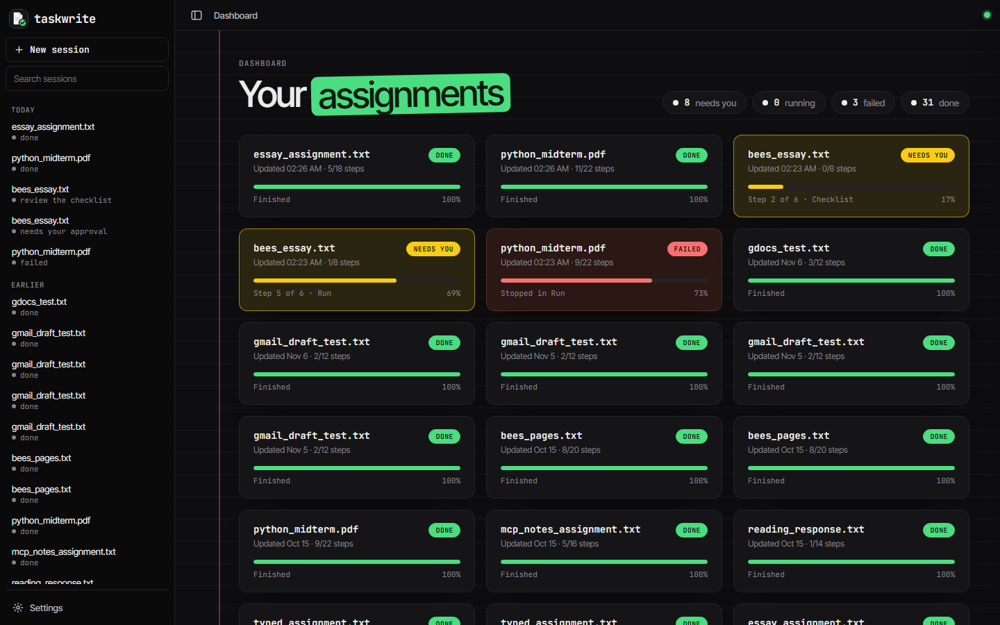
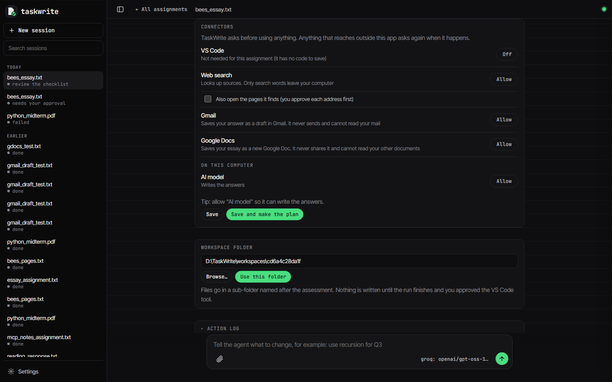
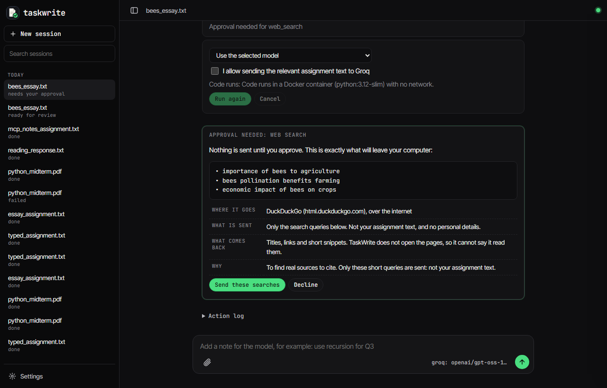
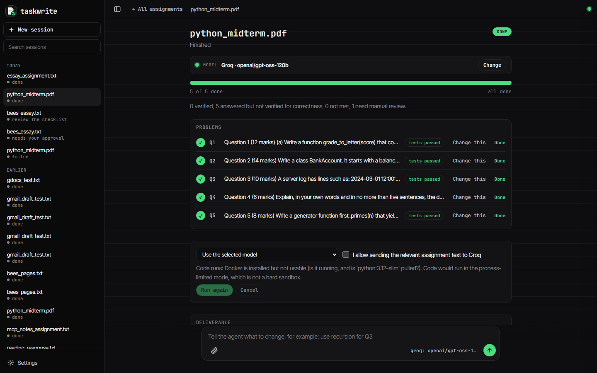
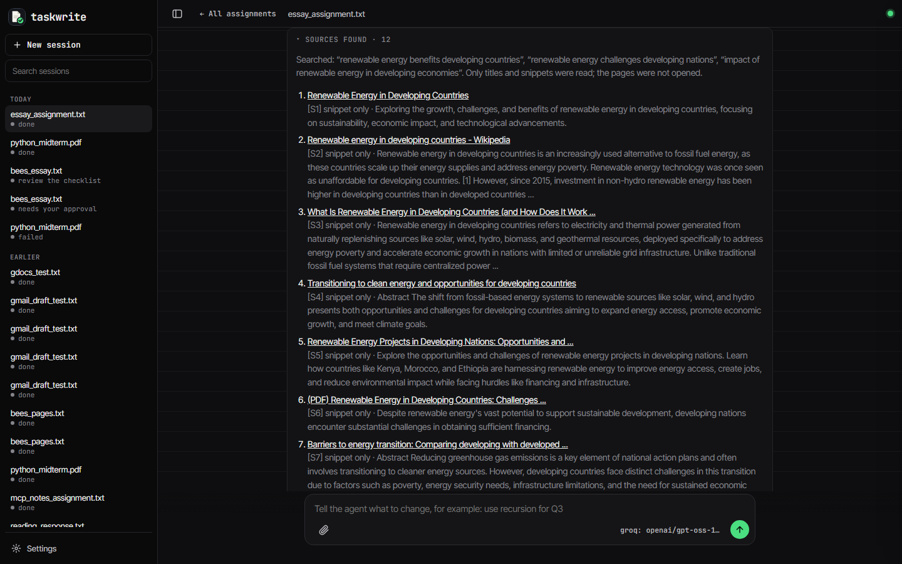
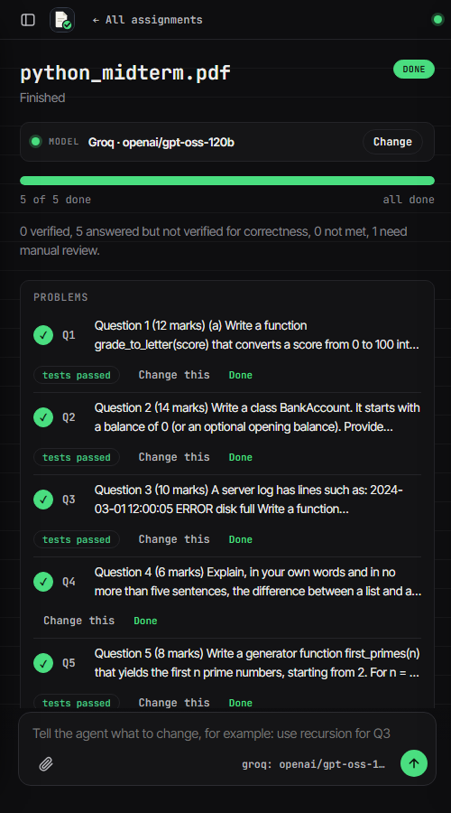

# TaskWrite

Open-source, local-first AI assignment agent. Upload a PDF/DOCX/TXT assignment; TaskWrite extracts it, builds an editable requirements checklist, asks you to approve tools and a plan, completes the work with your chosen model, validates every requirement, and lets you export the result (.md, .docx, .txt).

It works as a harness: plug in a model (local Ollama, or Groq, Gemini, OpenAI or Anthropic with your own key) and switch on the connectors you want (VS Code, web search, Gmail drafts, Google Docs). The model does the work through them, and every outside action asks you first. Groq, Gmail drafts and Google Docs were run end to end with real accounts; the Gemini, OpenAI and Anthropic adapters are tested against mocked responses only.

## Run it

```bash
python -m venv .venv
.venv\Scripts\activate        # macOS/Linux: source .venv/bin/activate
pip install -r requirements-dev.txt
copy .env.example .env        # then set OLLAMA_MODEL, e.g. a model from `ollama list`
uvicorn app.main:app --reload
```

Open http://localhost:8000/app. Install [Ollama](https://ollama.com) and pull a model first (`ollama pull <model>`); quality and speed depend on your hardware. No API key is needed for Ollama.

## Use a cloud model (your own API key)

1. Get a key from one or more of: [Google AI Studio](https://aistudio.google.com/apikey) (Gemini), the [Groq console](https://console.groq.com/keys), the [OpenAI platform](https://platform.openai.com/api-keys) or the [Anthropic console](https://console.anthropic.com/settings/keys). OpenAI and Anthropic API access is billed separately from ChatGPT or Claude subscriptions and needs API credits. Check each provider's current free-tier limits, prices and data-use terms yourself; they change, and free tiers may allow the provider to use your inputs.
2. Give TaskWrite the key in **one** of two ways:
   - put `GEMINI_API_KEY=...`, `GROQ_API_KEY=...`, `OPENAI_API_KEY=...` and/or `ANTHROPIC_API_KEY=...` in your `.env` file (it is git-ignored), then restart; or
   - open **Settings**, pick the provider, paste the key and press **Use key**. It is kept in memory only: never saved to disk or the database, never logged, never sent back to the browser. It is gone when you restart.
3. In Settings pick a model from the list the provider returns (model names are not hard-coded) and press **Save and test connection**.
4. Switch providers any time from the same dropdown. Nothing is sent anywhere just by switching.
5. A cloud provider receives the relevant assignment text, so the run card shows a consent tick box that names the provider. Without it the run is refused.

## Python assessments

Upload the assessment (PDF, DOCX or TXT), review the checklist, choose a **workspace folder**, approve `model`, `code_runner` and `vscode`, approve the plan and run. For each Python question TaskWrite writes the solution, writes tests, runs them in a restricted environment, uses the error output to attempt up to 2 fixes, and shows the code, the run result and a plain-English explanation. Files are saved to `<workspace>/<assessment name>/` (`q1.py`, `check_q1.py`, ..., `EXPLANATIONS.md`) only after you approved the VS Code tool.

What the results mean (this is deliberate):

- **ran without errors** - the code executed. Nothing more.
- **tests passed** - the tests the model wrote for itself passed. This does **not** prove the solution is correct; the tests can be wrong or too easy. Read the code.
- **failed / not run** - shown with the error or the reason.

**Where code runs.** If Docker is installed and the image is pulled (`docker pull python:3.12-slim`), code runs in a throwaway container with no network, a read-only filesystem, memory/CPU/process limits and no privileges. Otherwise it runs in a locked-down child process: empty environment, temp working folder, timeout, a Windows Job Object memory cap (resource limits on Linux/macOS), and an in-process guard that refuses network, new processes and file access outside its temp folder. That fallback is defence in depth, **not a hard sandbox**; Settings shows which mode is active. To check what you actually have, run `python -m app.sandbox_check`: it tries 9 hostile programs (network, reading/writing outside the folder, reading your environment, starting programs or flooding processes, endless loops, huge memory, and a solution/test import) and prints which isolation level ran.

Running the whole app with `docker compose up --build` is supported, but inside that container code can only use the restricted-process mode (there is no Docker to start another container from). For Docker-isolated code, run TaskWrite directly on your computer with Docker Desktop installed. A text deny-list also runs first, but it is never the protection.

## Essays and web research

Upload (or type/paste) a written assignment such as "write an essay on X and cite your sources". TaskWrite offers a **web search** tool and a **Word** tool. If you approve web search, the plan gets a research step first:

1. The model picks up to 3 short search queries about the *topic only*.
2. **You see the exact queries on an approval screen, with the destination (DuckDuckGo), before anything is sent.** No assignment text is sent, and no API key is needed.
3. Only search-result **titles, links and snippets** come back. The pages are never opened, and TaskWrite will not claim they were read. Injection-looking text in a result is removed before the model sees it.
4. The essay may cite only those sources, written as `[S1]`, `[S2]`. A cited link or marker that is not in the search results is flagged as "not met" in the validation report. This catches invented references; it does **not** prove a source supports the sentence that cites it, so check them.
5. The deliverable ends with a **Sources** section (cited sources first, then "also found, not cited") and a short "How I approached this" note. With the Word tool approved, the same text is saved as a `.docx` in your workspace folder.

**Reading the pages themselves (optional).** If you also approve **Page reader**, a second research step proposes up to 3 of the result pages on different websites and shows you the exact addresses. Only after you approve are they opened, and only the first part of each page's text (about 3,000 characters) is kept. Safety rules in code: only addresses the search itself returned can be opened; only `http`/`https` on the standard ports; no logins in the address; the address must resolve to a public internet address, so your own computer, home network and cloud metadata addresses are refused, and every redirect is checked again; non-web files (PDFs and so on) are skipped; a page can be at most 600 KB. Page text is untrusted: injection-looking sentences are removed. The visited site can see your IP address. In the Sources section each source is marked **page opened** or **snippet only**, and the report says how many pages were really read.

Each search and each page opened counts against the step budget. If you decline the search, the essay is written with no sources and told not to invent any. Try it with `samples/essay_assignment.txt`.

## The dashboard and an assignment page

Run `start.bat` on Windows (or the `uvicorn` command above) and open http://127.0.0.1:8000/app.

- **Dashboard** - every assignment as a card with its status (needs you, running, failed, done) and a progress bar. The chips at the top filter the cards; **New session** attaches or pastes a new assignment. Delete one from the sidebar (press the cross twice); that removes it from the database but not files already saved in your workspace folder.
- **Assignment page** - one progress bar ("3 of 5 done"), a row per problem (done, working, waiting, failed), and anything that needs you at the top: approvals, or a question from the agent with tap-to-answer choices when it offers them.
- **Model picker** - shows the provider and model, and lets you switch. It is locked while a run is going, in the backend as well as on the page.
- **Connectors** - VS Code, Web search, Gmail and Google Docs, each off until you allow it for that assignment. Connectors listed in `mcp_servers.json` are connected automatically when the app starts.
- **Chat box** - type an instruction at any time. During a run it is queued and the next step picks it up. If the agent asked a question, what you type is your answer.
- **Change this** - on any finished problem: say what should be different and only that problem is redone, inside the same step budget and approvals.

## Working in your own apps

Approve the tools the assignment needs and TaskWrite hands the work to them, with no screen-control and no paid service:

- **VS Code** - code answers are saved as `.py` files in the workspace folder and opened with the `code` command.
- **Word** - written answers are saved as `.docx` and opened in your default `.docx` app.
- **Email** - an approval screen shows the recipient, subject and body. Only after you confirm does it open a draft in your mail app. TaskWrite never sends email and cannot tell you whether it was sent; you press Send.
- **Questions** - if the model cannot continue without information only you have, the run pauses and asks you.

Free by default (local Ollama). Groq, Gemini, OpenAI and Anthropic work with your own API key.

## Create the code files through VS Code (optional, MCP)

Instead of TaskWrite saving the files itself, you can let the **VS Code MCP extension** create them in the folder VS Code has open. This is for the code files only; TaskWrite still runs the code in its own sandbox.

1. In VS Code, install `JuehangQin.vscode-mcp-server` and open your TaskWrite workspace folder (File > Open Folder).
2. Put this in that folder's `.vscode/settings.json` (or your user settings). It turns the extension's **shell tool off** and starts its server:
   ```json
   {
     "vscode-mcp-server.enabledTools": { "file": true, "edit": true, "shell": false, "diagnostics": false, "symbol": false },
     "vscode-mcp-server.defaultEnabled": true
   }
   ```
3. Add the server to `mcp_servers.json` (see `mcp_servers.example.json`): `"vscode": { "url": "http://127.0.0.1:3000/mcp" }`. Only loopback addresses are accepted, because the extension has no login.
4. In TaskWrite choose the same workspace folder, press **Connect / refresh MCP servers**, and tick the VS Code tool. When the run finishes you get one card listing every file; untick any you do not want and approve.

What TaskWrite guarantees, and checks in code: it never overwrites an existing file; it never sends a path outside your workspace folder (the extension itself would accept `../`); it first proves VS Code's open folder is your workspace folder, using a temporary marker file; and it calls a file "created" only after reading it back from disk. Tools whose names say send, share, delete, permission or shell are hidden and blocked even if approved.

## Save a Gmail draft (optional, MCP)

TaskWrite can save your finished answer as a **draft** in your Gmail. It can never send it: you open the draft in Gmail, add a recipient and press Send yourself.

1. Install [uv](https://docs.astral.sh/uv/) (`winget install --id=astral-sh.uv -e` on Windows).
2. In Google Cloud Console: create a project, enable the **Gmail API**, set up the consent screen (External, add your own address as a **test user**), then create an **OAuth client ID** of type **Desktop app**.
3. Put the client ID and secret in `.env` (never in the config file):
   ```
   GOOGLE_OAUTH_CLIENT_ID=...
   GOOGLE_OAUTH_CLIENT_SECRET=...
   USER_GOOGLE_EMAIL=you@gmail.com
   ```
4. Add the `gmail` entry from `mcp_servers.example.json` to `mcp_servers.json` (use the full path to `uvx` if it is not on your PATH), restart TaskWrite, and press **Connect / refresh MCP servers**.
5. The first time, a Google page opens; click **Allow**. The sign-in is saved on your computer.

What to know: only one Gmail tool is offered (`draft_gmail_message`) and the server is started with its mail-reading and label tools switched off. The draft box on the approval card starts **unticked**. TaskWrite cannot read a draft back, so it says "the server says it saved a draft" and shows the draft ID; check your Gmail Drafts folder. Google's sign-in token for this server is broader than drafts alone (it includes read and modify scopes), so keep the client secret private and revoke access at https://myaccount.google.com/permissions if you stop using it.

## Save an essay as a Google Doc (optional, MCP)

Uses the same Google client and `USER_GOOGLE_EMAIL` as the Gmail draft above.

1. In Google Cloud Console, also **enable the Google Docs API and the Google Drive API** for your project.
2. Add the `gdocs` entry from `mcp_servers.example.json` to `mcp_servers.json`, restart TaskWrite and connect.
3. The first time, Google asks for the Docs permission; click **Allow**.

Using both Gmail drafts and Google Docs? Sign in **once for both** (start `workspace-mcp` with `--permissions gmail:drafts docs:full` and run its sign-in). Both servers share one saved sign-in per Google address, so signing in for one service alone replaces the other's permission.

Only `create_doc` is offered; the server is started with its reading, editing and listing tools switched off, and anything named share or delete is blocked in code. The "Save as a Google Doc" box starts **unticked**. The essay goes in as plain text (Markdown markers removed), with no folder and no sharing. TaskWrite cannot open the document to check it, so it says "the server says it created a Google Doc" and shows the link. Very long essays (over about 60,000 characters) are not sent; download the .docx instead. Google's token for this is broad (it can read and edit all your docs), so revoke it at https://myaccount.google.com/permissions when you stop using it.

## MCP tools

TaskWrite can use your own tools through [MCP](https://modelcontextprotocol.io) servers that run on your computer.

1. Copy `mcp_servers.example.json` to `mcp_servers.json` and list your servers (same format as Claude Desktop). The example uses a small demo server in `samples/` that reads and writes plain-text notes, so you can try it with no downloads.
2. In the app, press **Connect / refresh MCP servers**. Each tool it finds shows up in the tool approvals list, unapproved.
3. Approve the tools an assignment needs. Read-only tools then run by themselves; any tool that could change something stops and asks you first, showing the exact arguments.

The model only proposes tool calls. The backend checks approval and the tool's own argument schema, counts every call against the step budget, and treats whatever comes back as untrusted data. Servers you add run with your permissions, so only add servers you trust.

## How it stays safe

- Uploaded text is untrusted data. Lines that look like prompt injection are flagged and removed before reaching a model.
- No tool runs without per-session approval, re-checked in backend code before every use.
- Plans are validated in code (allowed action kinds, unique ids, approved tools only). Editing a plan requires re-approval.
- `MAX_AGENT_STEPS` (default 8) caps model/tool actions, including retries and repairs. At the cap the run pauses with its state saved; you choose to add steps.
- If the model is unreachable, nothing is silently sent elsewhere. You may explicitly choose the limited rule-based fallback (plain arithmetic only).
- Results are labelled honestly: "verified" only when a tool computed it; otherwise "addressed, not verified". Citations are never verified.
- Generated Python only runs after you approve the code runner, in Docker when available, otherwise in a restricted process (see above). The restricted-process fallback is **not** a hardened sandbox.
- API keys live in memory or your `.env`; they are redacted from logs and errors and never returned by the API.
- The server only answers requests addressed to this computer (127.0.0.1, localhost), and only accepts changes from its own page, so another website cannot read your sessions or press buttons for you.

## Screenshots

| | |
| --- | --- |
|  |  |
|  |  |
|  |  |

These are from real runs of the synthetic samples in `samples/`.

## Tests

```bash
pytest
```

The suite needs no network, API key or Docker. It includes 30 synthetic evaluation cases (`tests/eval_cases.py`) that check question coverage, classification, tool offers and injection flags, plus tests for every guardrail: tool approval, plan validation, step caps (including retries, searches and page opens), prompt injection, secret redaction, provider errors and fallback, the code sandbox, citations, exports and session resumption. Real-model checks (Groq run of the sample exams, live search) were done by hand and are described in the project history; they depend on your own keys.

See [CONTRIBUTING.md](CONTRIBUTING.md) before opening a pull request.

Known gaps: only the first part of an opened page is read; question detection is rules-based, so unusual exam layouts can still be split wrongly (check the checklist, it is editable); the process-limited code sandbox is not a hard sandbox without Docker. Groq was run end to end with a real key. The Gemini, OpenAI and Anthropic adapters are tested against mocked responses only (the Gemini test account had no credits), so run each once with your own key to confirm.

## License

[MIT](LICENSE). Use it, change it and share it freely; it comes with no warranty.
